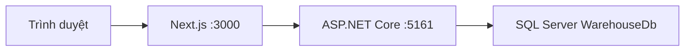
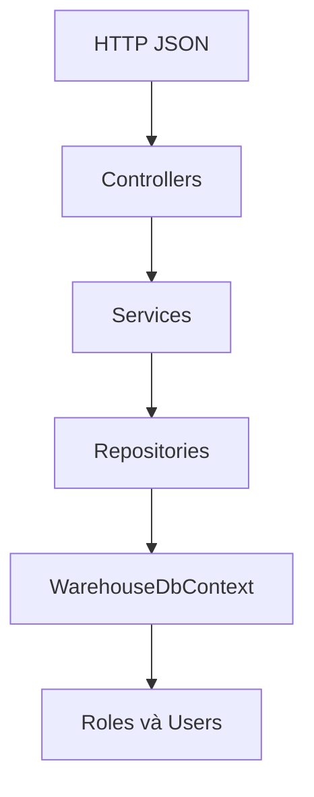

# warehouse-management-system

Hệ thống quản lý kho. Backend là ASP.NET Core Web API trên .NET 10 và SQL Server. Frontend là Next.js, chạy riêng và không nằm trong Compose của backend.

## Mục lục

- [Cấu trúc thư mục](#cấu-trúc-thư-mục)
- [Nguyên lý hoạt động](#nguyên-lý-hoạt-động)
- [Chạy nhanh](#chạy-nhanh)
- [Backend](backend/README.md)
  - [Cấu trúc thư mục](backend/README.md#cấu-trúc-thư-mục)
  - [Nguyên lý hoạt động](backend/README.md#nguyên-lý-hoạt-động)
  - [Nhiệm vụ từng thư mục và từng file](backend/README.md#nhiệm-vụ-từng-thư-mục-và-từng-file)
  - [Auth](backend/Modules/Auth/README.md)
  - [Roles](backend/Modules/Roles/README.md)
  - [Users](backend/Modules/Users/README.md)
  - [Một request đi qua đâu](backend/README.md#một-request-đi-qua-đâu)
  - [Ba nghiệp vụ](backend/README.md#ba-nghiệp-vụ)
  - [Danh sách API](backend/README.md#danh-sách-api)
  - [Cài đặt](backend/README.md#cài-đặt)
  - [Chạy API trên máy](backend/README.md#chạy-api-trên-máy)
  - [Chạy bằng Docker](backend/README.md#chạy-bằng-docker)
  - [Biến môi trường](backend/README.md#biến-môi-trường)
- [Frontend](frontend/README.md)
  - [Cài đặt](frontend/README.md#cài-đặt)
  - [Biến môi trường](frontend/README.md#biến-môi-trường)
  - [Chạy trên máy](frontend/README.md#chạy-trên-máy)
  - [Chạy bằng Docker](frontend/README.md#chạy-bằng-docker)
  - [Luồng gọi API](frontend/README.md#luồng-gọi-api)
  - [Thư mục và file](frontend/README.md#thư-mục-và-file)

## Cấu trúc thư mục

```text
Manage-Warehouse/
├── README.md
├── backend/          ASP.NET Core Web API, .NET 10, SQL Server
└── frontend/         Next.js, gọi API qua route nội bộ
```

Cây đầy đủ của API, kèm nhiệm vụ từng file, nằm ở [backend/README.md](backend/README.md#cấu-trúc-thư-mục).

## Nguyên lý hoạt động

Trình duyệt chỉ nói chuyện với Next.js. Next.js chuyển tiếp sang API. API kiểm tra token, rồi đọc ghi SQL Server.



Bên trong API, một request đi một chiều: controller nhận HTTP, service giữ quy tắc, repository chạy câu SQL, `WarehouseDbContext` mở bảng.



Đăng nhập là ngoại lệ ở cửa vào: `POST /api/auth/login` không cần token. Các đường dẫn còn lại cần header `Authorization: Bearer`. Chi tiết từng bước và từng file nằm ở [backend](backend/README.md#nguyên-lý-hoạt-động).

## Chạy nhanh

Mỗi phần có file `.env` riêng. Lần đầu, copy từ mẫu.

```bash
cd backend
cp .env.example .env
docker compose up -d
dotnet ef database update
dotnet run --launch-profile http
```

```bash
cd frontend
cp .env.example .env
npm install
npm run dev
```

Giao diện: [http://localhost:3000](http://localhost:3000)  
API: [http://localhost:5161](http://localhost:5161)

API và giao diện trong Docker, mỗi thư mục một Compose:

```bash
cd backend
docker compose --profile api up -d --build
```

```bash
cd frontend
docker compose up -d --build
```

Chi tiết cổng, migration, biến môi trường và lý do từng lệnh nằm trong README của [backend](backend/README.md) và [frontend](frontend/README.md).
