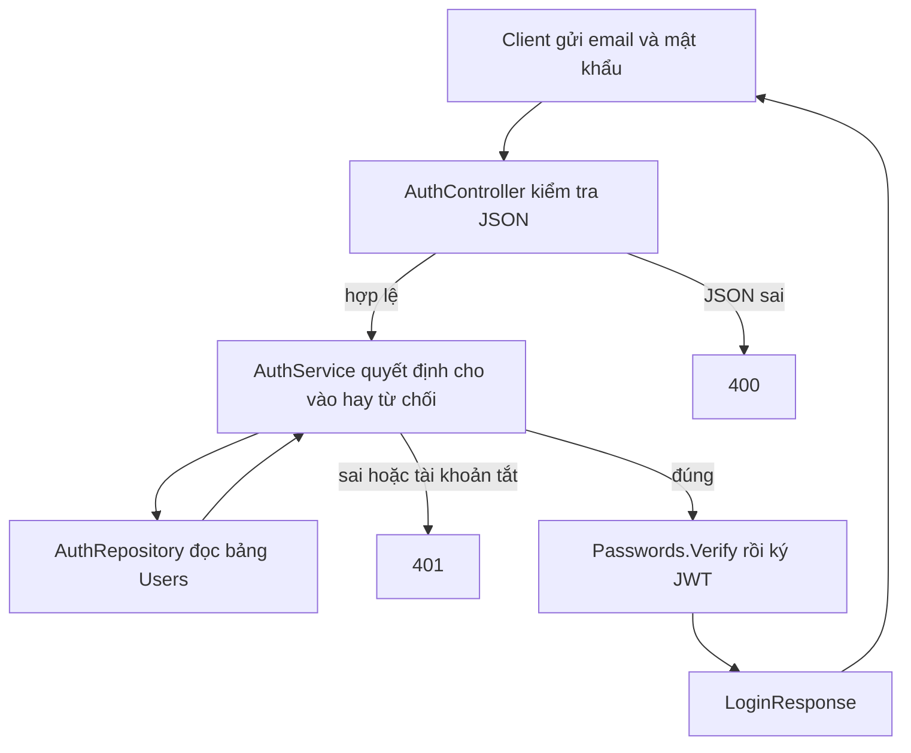

# Module Auth

Đăng nhập và mật khẩu. Module này không có bảng riêng. Người dùng nằm ở [Users](../Users/README.md), vai trò nằm ở [Roles](../Roles/README.md).

Quay lại bản đồ chung: [Backend](../../README.md).

## Nguyên lý hoạt động

Một request đăng nhập đi từ ngoài vào trong, rồi kết quả đi ngược ra. Mỗi tầng chỉ làm một việc.



### `POST /api/auth/login`

1. `AuthController.Login` nhận body. ASP.NET gán vào `LoginRequest` và chạy attribute. Email sai định dạng hoặc mật khẩu ngắn hơn 8 ký tự thì dừng, trả `400` và `{ "message" }`. Chưa gọi service.
2. Controller gọi `IAuthService.LoginAsync`. Phần làm thật là `AuthService`.
3. Service cắt khoảng trắng email, chuyển chữ thường, rồi gọi `IAuthRepository.FindByEmailWithRoleAsync`.
4. `AuthRepository` đọc bảng `Users`, kèm vai trò. Email trong bảng đã được module Users lưu ở dạng chữ thường, nên hai bên khớp nhau.
5. Service từ chối khi không có người dùng, hoặc `IsActive` là `false`, hoặc `Passwords.Verify` không khớp `PasswordHash`. Ba trường hợp này cùng trả `401`: "Email hoặc mật khẩu không đúng."
6. Đúng thì service đọc `Jwt:ExpiresMinutes`. Mặc định 480 phút. Nhỏ hơn 5 thì nâng lên 5. Khóa ký lấy từ `Jwt:SigningKey`, phải dài ít nhất 32 byte.
7. JWT mang `sub` là id, `email`, họ tên, và tên vai trò nếu người dùng đang có vai trò. Chữ ký HMAC-SHA256.
8. Service dựng `LoginResponse`: token, thời điểm hết hạn, `tokenType` là `Bearer`, và `UserSession`. Controller trả `200`.

`PasswordVault` không tham gia bước này. Bản mã hóa chỉ để admin xem lại mật khẩu ở module Users.

### `GET /api/auth/me`

1. Thiếu token hoặc token hỏng thì middleware JWT trong `Program.cs` trả `401` trước khi vào controller.
2. `AuthController.Me` đọc claim `sub`. Không phải `Guid` thì trả `401`: "Phiên đăng nhập không hợp lệ."
3. `AuthService.CurrentAsync` gọi `FindActiveByIdWithRoleAsync`. Hàm này chỉ lấy tài khoản còn `IsActive`.
4. Không thấy thì controller trả `401`. Thấy thì trả `UserSession`, không trả mật khẩu và không ký token mới.

## Thư mục và file

Chú thích ghi việc của từng chỗ. Đọc từ trên xuống là thứ tự một request đăng nhập đi qua.

```text
Auth/
├── Controllers/                 # Cửa HTTP. Đổi kết quả service thành mã HTTP.
│   └── AuthController.cs        # POST /api/auth/login để mở. GET /api/auth/me cần token.
├── DTOs/                        # Hình dạng JSON. Không có câu SQL, không ký token.
│   ├── LoginRequest.cs          # Body vào: email, password.
│   ├── JwtTokenDto.cs           # token, expiresAt, tokenType.
│   ├── LoginResponse.cs         # JwtTokenDto cộng thêm user.
│   └── UserSession.cs           # id, fullName, email, roleName.
├── Services/                    # Quy tắc: ai được vào, token mang gì, hết hạn bao lâu.
│   ├── IAuthService.cs          # Hợp đồng LoginAsync và CurrentAsync.
│   └── AuthService.cs           # So mật khẩu, ký JWT, dựng phiên.
├── Repositories/                # Chỉ đọc Users cho việc đăng nhập. Không ghi.
│   ├── IAuthRepository.cs       # Hợp đồng hai câu tìm.
│   └── AuthRepository.cs        # EF Core trên WarehouseDbContext.Users.
└── Helpers/                     # Mật khẩu. Đăng nhập chỉ gọi Verify.
    ├── Passwords.cs             # Băm và so hash. Không đảo ngược được.
    └── PasswordVault.cs         # Mã hóa AES để module Users cho admin xem lại.
```

Không có `Entity` và `Configurations`. Bảng và cột thuộc module Users.

### `Controllers/AuthController.cs`

| Action | Đường dẫn | Quyền | Kết quả |
| --- | --- | --- | --- |
| `Login` | `POST login` | Để mở | `200` và `LoginResponse`. Body sai thì `400`. `AppException` giữ mã của nó. |
| `Me` | `GET me` | Cần token | `200` và `UserSession`. `sub` không phải `Guid`, hoặc không còn phiên, thì `401`. |

`Me` đọc `sub`, rồi `ClaimTypes.NameIdentifier` nếu `sub` trống. `MapInboundClaims` tắt trong `Program.cs`, nên tên claim giữ nguyên lúc ký.

### `DTOs/LoginRequest.cs`

| Trường | Ràng buộc |
| --- | --- |
| `email` | Bắt buộc, tối đa 200 ký tự, đúng định dạng email. |
| `password` | Bắt buộc, 8–100 ký tự. |

Lỗi attribute đầu tiên thành câu trong `{ "message" }`.

### `DTOs/JwtTokenDto.cs`

`token` là chuỗi JWT. `expiresAt` là UTC. `tokenType` luôn `Bearer`.

### `DTOs/LoginResponse.cs`

Kế thừa `JwtTokenDto` và thêm `user` kiểu `UserSession`. Đây là body `200` của đăng nhập.

### `DTOs/UserSession.cs`

`id`, `fullName`, `email`, `roleName`. Không có hash, không có mật khẩu. Cả đăng nhập và `me` đều trả kiểu này.

### `Services/IAuthService.cs`

`LoginAsync` trả token hoặc ném `AppException` 401. `CurrentAsync` trả phiên, hoặc `null` khi tài khoản không còn hoạt động. Controller đổi `null` thành `401`.

### `Services/AuthService.cs`

Claim trong token:

| Claim | Giá trị |
| --- | --- |
| `sub` | Id người dùng. |
| `email` | Email. |
| `ClaimTypes.Name` | Họ tên. |
| `ClaimTypes.Role` | Tên vai trò. Chỉ thêm khi người dùng đang có vai trò. |

Issuer và audience lấy từ `Jwt:Issuer`, `Jwt:Audience`. Khóa thiếu hoặc ngắn hơn 32 byte thì `500`.

### `Repositories/IAuthRepository.cs`

Không thêm, không sửa, không xóa.

| Hàm | Việc |
| --- | --- |
| `FindByEmailWithRoleAsync` | Tìm theo email, kèm vai trò. Dùng lúc đăng nhập. |
| `FindActiveByIdWithRoleAsync` | Tìm theo id và `IsActive` là `true`, không theo dõi thay đổi. Dùng cho `me`. |

### `Repositories/AuthRepository.cs`

Hai hàm trên chạy trên `WarehouseDbContext.Users`. Đăng nhập cần thực thể có `PasswordHash` nên câu tìm theo email theo dõi được bản ghi. `me` chỉ đọc nên dùng `AsNoTracking`.

### `Helpers/Passwords.cs`

`PasswordHasher<User>` của ASP.NET Identity.

| Hàm | Việc |
| --- | --- |
| `Hash` | Tạo `PasswordHash`. Module Users gọi khi tạo hoặc đặt lại mật khẩu. |
| `Verify` | So chữ người dùng gõ với hash. Hash trống thì `false`. Module này gọi lúc đăng nhập. |

### `Helpers/PasswordVault.cs`

AES để admin xem lại chữ mật khẩu. Không dùng để đăng nhập.

| Hàm | Việc |
| --- | --- |
| `Protect` | Khóa là SHA-256 của `Jwt:SigningKey`. IV ngẫu nhiên ghép ciphertext, viết Base64. |
| `Open` | Giải mã. Chuỗi trống thì `null`. |

Đổi `Jwt:SigningKey` thì bản đã mã hóa không mở lại được.
