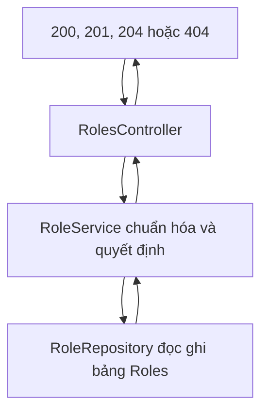

# Module Roles

Một vai trò có tên và mô tả. Người dùng trỏ tới vai trò bằng `RoleId`. Vai trò không giữ danh sách người dùng.

Quay lại bản đồ chung: [Backend](../../README.md). Đăng nhập: [Auth](../Auth/README.md). Người dùng: [Users](../Users/README.md).

## Nguyên lý hoạt động

Mọi đường `/api/roles` cần token. Controller không xét người gọi có phải admin hay không. Quy tắc tên, độ dài và trùng tên nằm ở service. Câu SQL nằm ở repository.



### Xem danh sách `GET /api/roles`

1. `RolesController.Search` lấy `search`, `page` mặc định 1, `pageSize` mặc định 10.
2. `RoleService.SearchAsync` gọi `PageRequest.Normalize`. Trang nhỏ hơn 1 thành 1. Kích thước nhỏ hơn 1 thành 10, lớn hơn 100 thành 100.
3. `RoleRepository.SearchAsync` đọc `Roles` bằng `AsNoTracking`. `TextSearch` đổi từ khóa thành mẫu `LIKE` trên `Name` và `Description`, không phân biệt hoa thường và dấu.
4. Sắp theo tên, cắt trang, chiếu thẳng ra `RoleResponse`. Controller trả `200`. Không có dòng nào thì `items` rỗng, không phải `404`.

### Xem một vai trò `GET /api/roles/{id}`

`RoleRepository.GetByIdAsync` chiếu một `RoleResponse`. Không có thì service trả `null`, controller trả `404`: "Không tìm thấy vai trò."

### Tạo `POST /api/roles`

1. ASP.NET kiểm tra `UpsertRoleRequest`. Tên trống hoặc mô tả dài hơn 500 thì `400` ngay.
2. `RoleService.Normalize` cắt khoảng trắng. Tên rỗng hoặc dài hơn 150 thì `400`. Mô tả chỉ có khoảng trắng thì lưu `null`. Dài hơn 500 thì `400`.
3. `NameExistsAsync` thấy tên đã có thì `409`: "Tên vai trò đã tồn tại."
4. Service tạo `Role` với `Guid` mới, `Add`, rồi `SaveChangesAsync`.
5. `RoleMapper.ToDto` dựng JSON sau khi đã lưu. Controller trả `201`, header trỏ tới `GetById`.

### Sửa `PUT /api/roles/{id}`

1. `FindAsync` lấy thực thể đang được EF theo dõi. Không có thì `null`, controller trả `404`.
2. Chuẩn hóa và kiểm tra trùng tên. `exceptId` là id đang sửa, nên giữ nguyên tên của chính nó vẫn hợp lệ.
3. Gán `Name`, `Description`, lưu. Mapper trả `RoleResponse`. Controller trả `200`.

### Xóa `DELETE /api/roles/{id}`

`FindAsync` không thấy thì `false`, controller trả `404`. Thấy thì `Remove` và lưu, controller trả `204`.

Xóa chỉ gỡ hàng trong `Roles`. Cấu hình người dùng đặt `OnDelete(SetNull)`, nên `RoleId` của người đang giữ vai trò đó thành null. Người dùng không bị xóa.

`IRoleRepository.ExistsAsync` không phục vụ các API trên. Module Users gọi nó trước khi gán `RoleId`.

## Thư mục và file

```text
Roles/
├── Controllers/                 # Cửa HTTP /api/roles. Đổi null và false thành 404, 204.
│   └── RolesController.cs       # Search, GetById, Create, Update, Delete. Cả class cần token.
├── DTOs/                        # JSON vào và JSON ra. Chưa phải dòng trong database.
│   ├── UpsertRoleRequest.cs     # Body tạo và sửa: name, description.
│   └── RoleResponse.cs          # id, name, description trả cho client.
├── Services/                    # Quy tắc nghiệp vụ. Ném AppException khi dữ liệu sai hoặc trùng tên.
│   ├── IRoleService.cs          # Hợp đồng CRUD. Không thấy bản ghi thì null hoặc false.
│   └── RoleService.cs           # Cắt chuỗi, cấm trùng tên, gọi repository.
├── Repositories/                # Câu SQL. Không quyết định mã HTTP.
│   ├── IRoleRepository.cs       # Hợp đồng tìm, kiểm tra tên, thêm, xóa, lưu.
│   └── RoleRepository.cs        # EF Core trên DbSet Roles.
├── Entity/                      # Đối tượng một hàng trong bảng Roles.
│   └── Role.cs                  # Id, Name, Description.
├── Configurations/              # EF áp cột, độ dài, chỉ mục. Không chạy trong từng request.
│   └── RoleConfiguration.cs     # Bảng Roles, Name duy nhất tối đa 150.
└── Helpers/                     # Dựng DTO sau khi đã lưu trong bộ nhớ.
    └── RoleMapper.cs            # ToDto. Danh sách không đi qua file này.
```

### `Controllers/RolesController.cs`

Route `api/roles`. `[Authorize]` trên cả class. `Execute` bắt `AppException` và trả `{ "message" }` với mã trong exception.

| Action | Đường dẫn | Kết quả |
| --- | --- | --- |
| `Search` | `GET /` | `200` và trang. |
| `GetById` | `GET /{id}` | `200`, hoặc `404`. |
| `Create` | `POST /` | `201`. |
| `Update` | `PUT /{id}` | `200`, hoặc `404`. |
| `Delete` | `DELETE /{id}` | `204`, hoặc `404`. |

### `DTOs/UpsertRoleRequest.cs`

| Trường | Attribute |
| --- | --- |
| `name` | Bắt buộc, 1–150 ký tự. |
| `description` | Tối đa 500, được bỏ trống. |

Service kiểm tra lại sau khi cắt khoảng trắng, vì interface có thể được gọi không qua HTTP.

### `DTOs/RoleResponse.cs`

`id`, `name`, `description`. Danh sách bọc nó trong `PagedResult`: `items`, `page`, `pageSize`, `totalCount`, `totalPages`.

### `Services/IRoleService.cs`

| Hàm | Khi không thấy bản ghi |
| --- | --- |
| `SearchAsync` | Trang rỗng. |
| `GetByIdAsync` | `null`. |
| `CreateAsync` | Luôn trả vai trò vừa tạo, hoặc ném `AppException`. |
| `UpdateAsync` | `null`. |
| `DeleteAsync` | `false`. |

### `Services/RoleService.cs`

`Normalize` là chỗ duy nhất quyết định chuỗi được lưu. `EnsureNameAvailable` là chỗ duy nhất ném `409`.

### `Repositories/IRoleRepository.cs`

| Hàm | Việc |
| --- | --- |
| `SearchAsync` | Một trang đã lọc. |
| `GetByIdAsync` | `RoleResponse` hoặc `null`. Không theo dõi thay đổi. |
| `FindAsync` | Thực thể đang theo dõi, để sửa hoặc xóa. |
| `NameExistsAsync` | Tên đã có ở bản ghi khác. `exceptId` bỏ qua chính vai trò đang sửa. |
| `ExistsAsync` | Có id này hay không. Module Users gọi trước khi gán vai trò. |
| `Add`, `Remove`, `SaveChangesAsync` | Đưa vào context và ghi SQL Server. |

### `Repositories/RoleRepository.cs`

Tìm trên `Name` và `Description`. Sắp theo tên, rồi `Skip` và `Take`. `GetByIdAsync` dùng `Select` nên không kéo cả thực thể. `FindAsync` lấy thực thể để service gán thuộc tính rồi lưu.

### `Entity/Role.cs`

| Thuộc tính | Ý nghĩa |
| --- | --- |
| `Id` | `Guid`. Service tự sinh khi tạo. |
| `Name` | Tên. `admin` do `DbInitializer` tạo lúc API khởi động. |
| `Description` | Mô tả, có thể trống. |

### `Configurations/RoleConfiguration.cs`

`WarehouseDbContext` nạp file này vì nó implement `IEntityTypeConfiguration<Role>`.

| Cột | Ràng buộc |
| --- | --- |
| `Id` | Khóa chính. |
| `Name` | Bắt buộc, tối đa 150, chỉ mục duy nhất. |
| `Description` | Tối đa 500, được phép null. |

### `Helpers/RoleMapper.cs`

`ToDto` chạy sau `SaveChanges`, khi thực thể đã nằm trong bộ nhớ. Danh sách và xem theo id chiếu trong câu SQL, không gọi mapper, để EF không kéo thừa cột.
