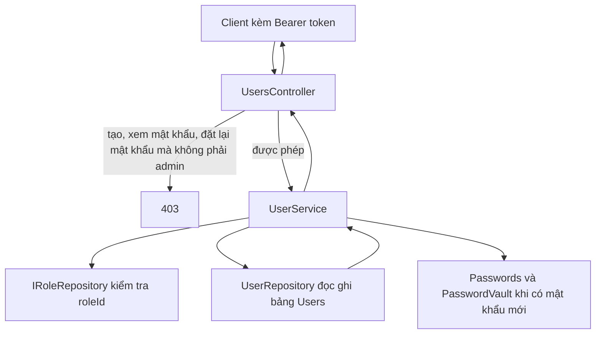

# Module Users

Hồ sơ, mật khẩu và vai trò của từng người. Đăng nhập đọc bảng này, nhưng chữ ký JWT nằm ở [Auth](../Auth/README.md). Bảng vai trò nằm ở [Roles](../Roles/README.md).

Quay lại bản đồ chung: [Backend](../../README.md).

## Nguyên lý hoạt động

Mọi đường `/api/users` cần token. Controller chặn quyền admin trước khi gọi service. Service chuẩn hóa dữ liệu và ghi hai dạng mật khẩu. Repository chỉ chạy SQL.



### Xem danh sách `GET /api/users`

1. Mọi token hợp lệ đều gọi được. Controller không xét admin.
2. `UserService.SearchAsync` chuẩn hóa `page` và `pageSize` bằng `PageRequest`.
3. `UserRepository.SearchAsync` tìm không phân biệt hoa thường và dấu trên họ tên, email, điện thoại và tên vai trò. Sắp theo họ tên.
4. Mỗi dòng là `UserResponse`. `hasPassword` là `true` khi `PasswordHash` có chữ. Mật khẩu và hash không ra JSON. Controller trả `200`.

### Xem một người `GET /api/users/{id}`

`GetByIdAsync` chiếu một `UserResponse`. Không có thì `404`: "Không tìm thấy người dùng."

### Tạo `POST /api/users`

1. `UsersController.Create` đọc claim vai trò. Không phải `admin` thì `403`: "Chỉ vai trò admin mới đặt được mật khẩu." Chưa vào service.
2. ASP.NET kiểm tra `CreateUserRequest`. Thiếu họ tên, email, hoặc mật khẩu thì `400`.
3. `UserService.Normalize` cắt chuỗi, đưa email về chữ thường, kiểm tra lại độ dài. Mật khẩu bắt buộc, 8–100 ký tự.
4. `EmailExistsAsync` thấy email đã có thì `409`: "Email đã tồn tại."
5. `roleId` có giá trị thì `IRoleRepository.ExistsAsync`. Không có vai trò đó thì `400`: "Vai trò không tồn tại." `roleId` trống thì được phép.
6. `StorePassword` ghi cùng lúc `PasswordHash` qua `Passwords.Hash` và `PasswordReveal` qua `PasswordVault.Protect`.
7. Repository `Add` và lưu. Service đọc lại hồ sơ. Không đọc lại được thì `500`. Controller trả `201`.

### Sửa `PUT /api/users/{id}`

1. Body có mật khẩu mới mà người gọi không phải admin thì `403`: "Chỉ vai trò admin mới đặt lại được mật khẩu."
2. Mật khẩu trống hoặc chỉ khoảng trắng thì mọi token hợp lệ đều sửa được hồ sơ. Hai cột mật khẩu giữ nguyên.
3. `FindAsync` không thấy người dùng thì `404`.
4. Chuẩn hóa giống lúc tạo, nhưng mật khẩu không bắt buộc. Email trùng người khác thì `409`. `roleId` lạ thì `400`.
5. Có mật khẩu sau chuẩn hóa thì `StorePassword` ghi đè cả hash lẫn bản mã hóa. Controller trả `200` và `UserResponse`.

### Xem mật khẩu `GET /api/users/{id}/password`

1. Không phải admin thì `403`: "Chỉ vai trò admin mới xem được mật khẩu."
2. `FindReadOnlyAsync` không thấy thì `404`.
3. `PasswordVault.Open` giải `PasswordReveal`. Cột trống thì `password` là `null` nhưng HTTP vẫn `200`.
4. Khóa `Jwt:SigningKey` thiếu hoặc ngắn hơn 32 byte thì `500`.

Route `{id}/password` khai báo trước route `{id}` để chữ `password` không bị nhận thành một id.

### Xóa `DELETE /api/users/{id}`

Mọi token hợp lệ đều xóa được. Không thấy thì `404`. Xóa xong thì `204`. Không đụng bảng `Roles`.

## Mật khẩu nằm ở đâu

| Cột | File tạo ra | Dùng để |
| --- | --- | --- |
| `PasswordHash` | `Auth/Helpers/Passwords.cs` | Đăng nhập. Băm một chiều. |
| `PasswordReveal` | `Auth/Helpers/PasswordVault.cs` | Admin xem chữ gốc. Khóa là SHA-256 của `Jwt:SigningKey`. |

Hai cột được ghi trong cùng `StorePassword`. Đổi khóa ký JWT thì bản mã hóa cũ không mở được. Hash đăng nhập không phụ thuộc khóa đó.

## Thư mục và file

```text
Users/
├── Controllers/                 # Cửa HTTP /api/users. Chặn admin trước khi gọi service.
│   └── UsersController.cs       # Danh sách, xem, tạo, sửa, xóa, xem mật khẩu.
├── DTOs/                        # JSON vào và JSON ra. Không chứa hash.
│   ├── UserWriteRequest.cs      # Hồ sơ dùng chung. Create bắt buộc mật khẩu. Update thì mật khẩu tùy chọn.
│   ├── UserResponse.cs          # Hồ sơ trả về, có hasPassword.
│   └── UserPasswordResponse.cs  # Một trường password cho admin.
├── Services/                    # Quy tắc hồ sơ và chỗ ghi hai dạng mật khẩu.
│   ├── IUserService.cs          # Hợp đồng CRUD cộng GetPasswordAsync.
│   └── UserService.cs           # Chuẩn hóa, cấm trùng email, gọi Roles để kiểm tra roleId.
├── Repositories/                # Câu SQL trên bảng Users. Không biết ai là admin.
│   ├── IUserRepository.cs       # Hợp đồng tìm, kiểm tra email, thêm, xóa, lưu.
│   └── UserRepository.cs        # EF Core, tìm cả trên tên vai trò.
├── Entity/                      # Một hàng trong bảng Users.
│   └── User.cs                  # Hồ sơ, hai cột mật khẩu, RoleId, IsActive.
├── Configurations/              # EF áp cột và khóa ngoại. Chạy lúc tạo model, không chạy từng request.
│   └── UserConfiguration.cs     # Bảng Users. Xóa vai trò thì RoleId thành null.
└── Helpers/                     # Dựng UserResponse khi thực thể đã ở trong bộ nhớ.
    └── UserMapper.cs            # ToDto. Danh sách hiện không đi qua file này.
```

### `Controllers/UsersController.cs`

`[Authorize]` trên cả class. `IsAdmin` đọc `ClaimTypes.Role`, rồi claim `role`, so với `admin` không phân biệt hoa thường.

| Action | Đường dẫn | Thêm điều kiện | Kết quả |
| --- | --- | --- | --- |
| `Search` | `GET /` | Token | `200` và trang. |
| `GetById` | `GET /{id}` | Token | `200` hoặc `404`. |
| `GetPassword` | `GET /{id}/password` | Admin | `200`, `404`, hoặc `403`. |
| `Create` | `POST /` | Admin | `201` hoặc `403`. |
| `Update` | `PUT /{id}` | Admin nếu body có mật khẩu mới | `200`, `404`, hoặc `403`. |
| `Delete` | `DELETE /{id}` | Token | `204` hoặc `404`. |

`AppException` từ service thành `{ "message" }` với mã trong exception.

### `DTOs/UserWriteRequest.cs`

| Trường | Ràng buộc |
| --- | --- |
| `fullName` | Bắt buộc, 1–150 ký tự. |
| `email` | Bắt buộc, tối đa 200, đúng định dạng email. |
| `phone` | Trống thì hợp lệ. Có chữ thì đúng dạng số, tối đa 20. |
| `roleId` | `Guid` hoặc trống. |
| `isActive` | `bool`. |

`CreateUserRequest` thêm `password` bắt buộc, 8–100 ký tự. `UpdateUserRequest` thêm `password` tùy chọn. Có chữ mà ngoài khoảng 8–100 thì `400`.

### `DTOs/UserResponse.cs`

`id`, `fullName`, `email`, `phone`, `roleId`, `roleName`, `isActive`, `hasPassword`.

### `DTOs/UserPasswordResponse.cs`

Một trường `password`. Có người dùng nhưng chưa có `PasswordReveal` thì giá trị là `null` và HTTP vẫn `200`.

### `Services/IUserService.cs`

| Hàm | Khi không thấy người dùng |
| --- | --- |
| `SearchAsync` | Trang rỗng. |
| `GetByIdAsync` | `null`. |
| `GetPasswordAsync` | `null`. Có người dùng thì luôn trả `UserPasswordResponse`. |
| `CreateAsync` | Trả hồ sơ vừa tạo, hoặc ném `AppException`. |
| `UpdateAsync` | `null`. |
| `DeleteAsync` | `false`. |

Interface không kiểm tra admin. Controller làm việc đó.

### `Services/UserService.cs`

Dùng `IUserRepository`, `IRoleRepository` và `IConfiguration`.

| Kiểm tra trong `Normalize` và các bước sau | Lỗi |
| --- | --- |
| Họ tên rỗng hoặc dài hơn 150 | `400` "Họ tên là bắt buộc và tối đa 150 ký tự." |
| Email rỗng, dài hơn 200, hoặc không có `@` và `.` | `400` "Email không hợp lệ." |
| Điện thoại dài hơn 20 | `400` "Số điện thoại tối đa 20 ký tự." Trống thì lưu `null`. |
| Tạo mà không có mật khẩu | `400` "Mật khẩu là bắt buộc." |
| Mật khẩu có chữ nhưng ngoài 8–100 | `400` "Mật khẩu từ 8 đến 100 ký tự." |
| Email đã tồn tại ở người khác | `409` "Email đã tồn tại." |
| `roleId` không có trong bảng vai trò | `400` "Vai trò không tồn tại." Trống thì được. |

Email được cắt khoảng trắng và chuyển chữ thường trước khi so trùng và trước khi lưu.

### `Repositories/IUserRepository.cs`

| Hàm | Việc |
| --- | --- |
| `SearchAsync` | Một trang hồ sơ đã lọc. |
| `GetByIdAsync` | `UserResponse` hoặc `null`. |
| `FindAsync` | Thực thể đang theo dõi, để sửa hoặc xóa. |
| `FindReadOnlyAsync` | Thực thể không theo dõi, để đọc `PasswordReveal`. |
| `EmailExistsAsync` | Email đã có ở bản ghi khác. `exceptId` bỏ qua người đang sửa. |
| `Add`, `Remove`, `SaveChangesAsync` | Ghi SQL Server. |

### `Repositories/UserRepository.cs`

`SearchAsync` và `GetByIdAsync` dùng `AsNoTracking` và `Select`. `hasPassword` đúng khi `PasswordHash` khác null và khác chuỗi rỗng. Tìm theo email lúc đăng nhập không nằm ở đây. Việc đó thuộc `AuthRepository`.

### `Entity/User.cs`

| Thuộc tính | Ý nghĩa |
| --- | --- |
| `Id` | `Guid`. Service tự sinh khi tạo. |
| `FullName` | Họ tên. |
| `Email` | Email đăng nhập, lưu chữ thường. |
| `PasswordHash` | Bản băm. Trống thì không đăng nhập được. |
| `PasswordReveal` | Bản mã hóa. Trống thì admin xem được người dùng nhưng `password` là `null`. |
| `Phone` | Có thể trống. |
| `RoleId` | Mã vai trò, có thể trống. |
| `Role` | Đối tượng vai trò khi câu truy vấn đã nạp kèm. |
| `IsActive` | `false` thì không đăng nhập được. Mặc định `true`. |

### `Configurations/UserConfiguration.cs`

| Cột hoặc quan hệ | Ràng buộc |
| --- | --- |
| `FullName` | Bắt buộc, tối đa 150. |
| `Email` | Bắt buộc, tối đa 200, chỉ mục duy nhất. |
| `PasswordHash`, `PasswordReveal` | Tối đa 500, được phép null. |
| `Phone` | Tối đa 20, được phép null. |
| `Role` | Khóa ngoại `RoleId`. Xóa vai trò thì `RoleId` thành null. Người dùng còn. |

### `Helpers/UserMapper.cs`

`ToDto` dựng `UserResponse` từ từng trường khi thực thể đã ở trong bộ nhớ. Danh sách và xem theo id chiếu trong `Select` của repository, không gọi mapper, để câu SQL chỉ lấy đúng cột cần trả.
