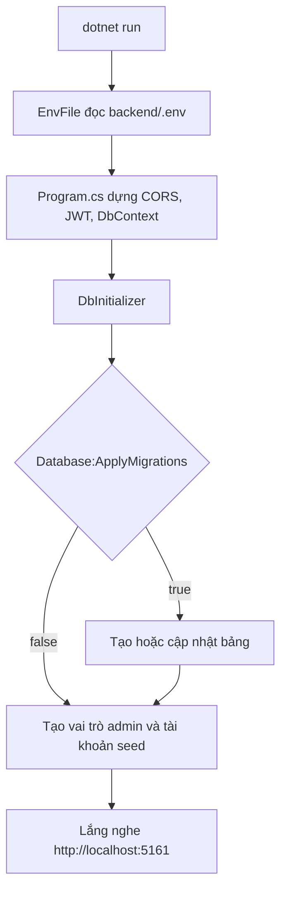
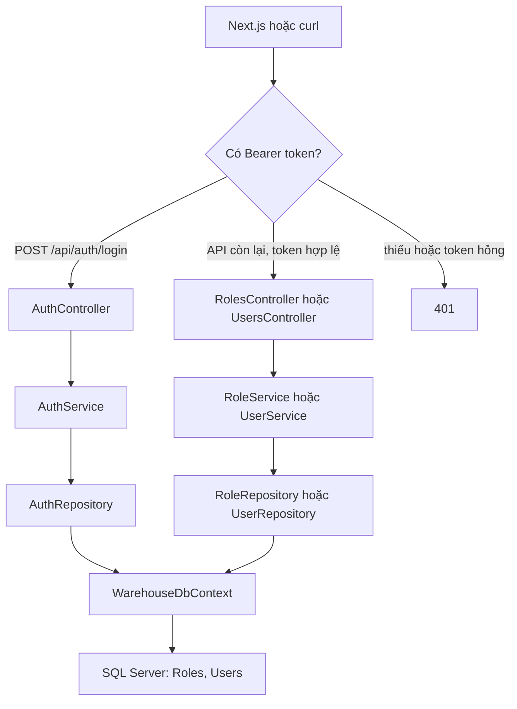

# Backend

API quản lý vai trò và người dùng. Một project ASP.NET Core Web API trên .NET 10, dữ liệu nằm trong SQL Server, database `WarehouseDb`.

## Cấu trúc thư mục

```text
backend/
├── Program.cs
├── UserManagementAPI.csproj
├── appsettings.json
├── appsettings.Development.json
├── .env.example
├── Dockerfile
├── docker-compose.yml
├── Common/
│   ├── Dtos/
│   │   ├── AppException.cs
│   │   ├── PageRequest.cs
│   │   ├── PagedResult.cs
│   │   └── ValidationAttributes.cs
│   └── Extensions/
│       ├── EnvFile.cs
│       └── ServiceCollectionExtensions.cs
├── Data/
│   ├── WarehouseDbContext.cs
│   ├── DbInitializer.cs
│   └── TextSearch.cs
├── Modules/
│   ├── Auth/
│   │   ├── Controllers/AuthController.cs
│   │   ├── DTOs/
│   │   ├── Helpers/
│   │   ├── Repositories/
│   │   └── Services/
│   ├── Roles/
│   │   ├── Configurations/RoleConfiguration.cs
│   │   ├── Controllers/RolesController.cs
│   │   ├── DTOs/
│   │   ├── Entity/Role.cs
│   │   ├── Helpers/RoleMapper.cs
│   │   ├── Repositories/
│   │   └── Services/
│   └── Users/
│       ├── Configurations/UserConfiguration.cs
│       ├── Controllers/UsersController.cs
│       ├── DTOs/
│       ├── Entity/User.cs
│       ├── Helpers/UserMapper.cs
│       ├── Repositories/
│       └── Services/
├── Migrations/
├── Properties/launchSettings.json
├── Tools/
└── wwwroot/
    ├── admin/
    ├── uploads/
    └── models/
```

`Auth` không có bảng riêng nên không có `Entity` và `Configurations`.

## Nguyên lý hoạt động

Lúc khởi động, API nạp cấu hình, nối database, tạo tài khoản admin nếu chưa có, rồi mới mở cổng.



Một request đã vào cổng đi theo một chiều. Controller không viết SQL. Service không trả mã HTTP. Repository không quyết định câu lỗi nghiệp vụ.



Ví dụ `POST /api/auth/login`:

1. `EnvFile` đã nạp `.env` trước khi host dựng. `Program.cs` kiểm tra khóa JWT dài ít nhất 32 byte.
2. `AuthController` nhận body. ASP.NET chạy attribute trên `LoginRequest`. Email sai hoặc mật khẩu ngắn hơn 8 ký tự thì trả `400` ngay, chưa vào service.
3. `AuthService` gọi `AuthRepository` tìm người dùng theo email, kiểm tra `IsActive`, rồi so mật khẩu với `PasswordHash`.
4. Sai email, sai mật khẩu, hoặc tài khoản tắt đều trả cùng một câu: "Email hoặc mật khẩu không đúng."
5. Đúng thì ký JWT. Token mang `sub`, email, họ tên và tên vai trò.
6. Controller trả `200` với token và `UserSession`.

Các API còn lại đi cùng lối: controller gọi service, service kiểm tra quy tắc, repository chạy câu SQL. Danh sách thêm `PageRequest` để chỉnh số trang và `TextSearch` để đổi từ khóa thành mẫu `LIKE` không phân biệt hoa thường và dấu.

## Nhiệm vụ từng thư mục và từng file

### Gốc project

| File | Nhiệm vụ |
| --- | --- |
| `Program.cs` | Ghép ứng dụng: nạp `.env`, bật controller, CORS, OpenAPI, JWT, đăng ký service, seed lúc khởi động, phục vụ `wwwroot`. |
| `UserManagementAPI.csproj` | Khai báo .NET 10 và các gói NuGet: JWT, OpenAPI, EF Core SQL Server. |
| `appsettings.json` | Mức log và chuỗi kết nối dự phòng. Giá trị trong `.env` ghi đè file này. |
| `appsettings.Development.json` | Mức log khi môi trường là Development. |
| `.env.example` | Mẫu biến môi trường. Sao chép thành `.env`. |
| `Dockerfile` | Build và chạy API trong image `aspnet:10.0`, cổng 8080. |
| `docker-compose.yml` | Service SQL Server. Profile `api` thêm container API, đợi SQL khỏe rồi tự áp migration. |
| `Properties/launchSettings.json` | Profile `http` mở `http://localhost:5161`. Profile `https` thêm cổng 7110. |

### `Common`

Dùng chung, không gắn một nghiệp vụ.

| File | Nhiệm vụ |
| --- | --- |
| `Dtos/AppException.cs` | Lỗi nghiệp vụ kèm mã HTTP. Controller bắt exception này và trả `{ "message" }`. |
| `Dtos/PageRequest.cs` | Đưa `page` nhỏ hơn 1 về 1. `pageSize` nhỏ hơn 1 thành 10, lớn hơn 100 thành 100. |
| `Dtos/PagedResult.cs` | Kết quả một trang: `items`, `page`, `pageSize`, `totalCount`, `totalPages`. |
| `Dtos/ValidationAttributes.cs` | `NotBlank` cấm chuỗi trống. `OptionalPassword` cho phép bỏ trống, có chữ thì 8–100 ký tự. `OptionalPhone` cho phép bỏ trống, có chữ thì đúng dạng số và tối đa 20 ký tự. |
| `Extensions/EnvFile.cs` | Đọc `.env` từ thư mục hiện tại hoặc thư mục chứa file chạy, lần lên tối đa 6 cấp. Biến đã có trong môi trường được giữ nguyên. |
| `Extensions/ServiceCollectionExtensions.cs` | `AddWarehouseServices` đăng ký `WarehouseDbContext` và toàn bộ repository, service. |

### `Data`

Nối SQL Server. Không chứa quy tắc của một màn hình.

| File | Nhiệm vụ |
| --- | --- |
| `WarehouseDbContext.cs` | Hai `DbSet`: `Roles` và `Users`. Nạp mọi `IEntityTypeConfiguration` trong assembly. |
| `DbInitializer.cs` | Nếu `Database:ApplyMigrations` là `true` thì cập nhật bảng. Luôn bảo đảm có vai trò `admin` và tài khoản seed. Tài khoản đã có mật khẩu thì không bị ghi đè. |
| `TextSearch.cs` | Đổi từ khóa thành `%từ khóa%`, thoát `%`, `_`, `[`. Collation `Latin1_General_100_CI_AI` nên `quan ly` khớp `Quản lý`. |

### `Modules/Auth`

Đăng nhập và mật khẩu. Không có bảng riêng. Chi tiết: [Auth](Modules/Auth/README.md).

| File | Nhiệm vụ |
| --- | --- |
| `Controllers/AuthController.cs` | `POST /api/auth/login` để mở. `GET /api/auth/me` cần token, đọc claim `sub`. |
| `DTOs/LoginRequest.cs` | Body đăng nhập: email bắt buộc tối đa 200 ký tự, mật khẩu 8–100 ký tự. |
| `DTOs/JwtTokenDto.cs` | `token`, `expiresAt`, `tokenType` là `Bearer`. |
| `DTOs/LoginResponse.cs` | Token kèm `UserSession`. |
| `DTOs/UserSession.cs` | Id, họ tên, email, tên vai trò. Không có mật khẩu. |
| `Helpers/Passwords.cs` | Băm một chiều bằng `PasswordHasher` để kiểm tra lúc đăng nhập. |
| `Helpers/PasswordVault.cs` | Mã hóa AES để admin xem lại mật khẩu. Khóa là SHA-256 của `Jwt:SigningKey`. |
| `Repositories/IAuthRepository.cs` | Hợp đồng tìm người dùng theo email hoặc theo id còn hoạt động, kèm vai trò. |
| `Repositories/AuthRepository.cs` | Hiện thực hai câu tìm đó trên bảng `Users`. |
| `Services/IAuthService.cs` | Hợp đồng đăng nhập và lấy phiên hiện tại. |
| `Services/AuthService.cs` | So mật khẩu, ký JWT. Hết hạn mặc định 480 phút, tối thiểu 5 phút. |

### `Modules/Roles`

Chi tiết: [Roles](Modules/Roles/README.md).

| File | Nhiệm vụ |
| --- | --- |
| `Entity/Role.cs` | `Id`, `Name`, `Description`. |
| `Configurations/RoleConfiguration.cs` | Bảng `Roles`. `Name` bắt buộc, tối đa 150, không trùng. `Description` tối đa 500. |
| `DTOs/UpsertRoleRequest.cs` | Body tạo và sửa vai trò. |
| `DTOs/RoleResponse.cs` | JSON một vai trò trả về. |
| `Helpers/RoleMapper.cs` | Dựng `RoleResponse` sau khi đã lưu. Không dùng bên trong câu truy vấn EF. |
| `Repositories/IRoleRepository.cs` | Hợp đồng tìm, xem, kiểm tra trùng tên, thêm, xóa, lưu. |
| `Repositories/RoleRepository.cs` | Câu SQL của vai trò, gồm tìm kiếm không phân biệt dấu. |
| `Services/IRoleService.cs` | Hợp đồng CRUD. Không thấy bản ghi thì xem và sửa trả `null`, xóa trả `false`. |
| `Services/RoleService.cs` | Cắt khoảng trắng, cấm tên rỗng hoặc dài quá 150, cấm mô tả dài quá 500, cấm trùng tên. |
| `Controllers/RolesController.cs` | `/api/roles`. Mọi action cần token. Không thấy vai trò thì `404`. Xóa xong thì `204`. |

### `Modules/Users`

Chi tiết: [Users](Modules/Users/README.md).

| File | Nhiệm vụ |
| --- | --- |
| `Entity/User.cs` | Hồ sơ, `PasswordHash`, `PasswordReveal`, `RoleId`, `IsActive`. `IsActive` mặc định `true`. |
| `Configurations/UserConfiguration.cs` | Bảng `Users`. Email không trùng. Xóa vai trò thì `RoleId` thành null, người dùng còn. |
| `DTOs/UserWriteRequest.cs` | Phần chung của tạo và sửa: họ tên, email, điện thoại, `roleId`, `isActive`. `CreateUserRequest` bắt buộc mật khẩu. `UpdateUserRequest` cho phép bỏ trống mật khẩu. |
| `DTOs/UserResponse.cs` | Hồ sơ trả cho danh sách và màn sửa. Có `hasPassword`, không có mật khẩu. |
| `DTOs/UserPasswordResponse.cs` | Một trường `password` cho đường xem mật khẩu. |
| `Helpers/UserMapper.cs` | Dựng `UserResponse` sau khi đã lưu. Danh sách hiện chiếu thẳng trong câu SQL, không đi qua mapper này. |
| `Repositories/IUserRepository.cs` | Hợp đồng tìm, xem, kiểm tra trùng email, thêm, xóa, lưu. |
| `Repositories/UserRepository.cs` | Câu SQL của người dùng. Tìm trên họ tên, email, điện thoại và tên vai trò. |
| `Services/IUserService.cs` | Hợp đồng CRUD cộng thêm `GetPasswordAsync`. |
| `Services/UserService.cs` | Chuẩn hóa email về chữ thường, cấm trùng email, cấm `roleId` không tồn tại, ghi cả hash và bản mã hóa khi có mật khẩu mới. |
| `Controllers/UsersController.cs` | `/api/users`. Tạo người dùng, xem mật khẩu, và sửa khi body có mật khẩu mới chỉ chạy khi claim vai trò là `admin`. Không phải admin thì `403`. |

### `Migrations`

EF Core ghi lịch sử bảng. File `*.Designer.cs` và `WarehouseDbContextModelSnapshot.cs` do công cụ sinh, dùng để so model lần sau. Không sửa tay.

| File | Việc đã làm |
| --- | --- |
| `20261011170323_AddRoles.cs` | Tạo bảng `Roles`. |
| `20261011170323_AddRoles.Designer.cs` | Model EF tại thời điểm migration đó. |
| `20261011180713_AddUsers.cs` | Tạo bảng `Users`. |
| `20261011180713_AddUsers.Designer.cs` | Model EF tại thời điểm migration đó. |
| `20261011182459_AddUserPassword.cs` | Thêm cột `PasswordHash`. |
| `20261011182459_AddUserPassword.Designer.cs` | Model EF tại thời điểm migration đó. |
| `20261011185655_AddPasswordReveal.cs` | Thêm cột `PasswordReveal`. |
| `20261011185655_AddPasswordReveal.Designer.cs` | Model EF tại thời điểm migration đó. |
| `WarehouseDbContextModelSnapshot.cs` | Model hiện tại. `dotnet ef migrations add` so file này với code để sinh migration mới. |

### `Tools` và `wwwroot`

`Tools` để dành cho tiện ích chạy tay. Hiện chưa có lệnh nào.

`wwwroot` là file tĩnh do ASP.NET phục vụ. `admin` nhận bản build giao diện. `uploads` chứa file tải lên lúc chạy. `models` chứa trọng số nhận diện khuôn mặt. Ba thư mục này đang trống.

## Một request đi qua đâu

Các bước của `POST /api/auth/login` và sơ đồ cả luồng nằm ở [Nguyên lý hoạt động](#nguyên-lý-hoạt-động). Danh sách vai trò và người dùng thêm `PageRequest` để chỉnh số trang và `TextSearch` để tìm không phân biệt hoa thường và dấu.

## Ba nghiệp vụ

### Đăng nhập

| Việc | Chỗ trong code |
| --- | --- |
| Body email và mật khẩu | `Modules/Auth/DTOs/LoginRequest.cs` |
| Token và phiên đăng nhập | `JwtTokenDto`, `LoginResponse`, `UserSession` |
| So mật khẩu, ký JWT | `Modules/Auth/Services/AuthService.cs` |
| Tạo admin mặc định | `Data/DbInitializer.cs` |
| `POST /api/auth/login`, `GET /api/auth/me` | `Modules/Auth/Controllers/AuthController.cs` |

Sai email, sai mật khẩu, hoặc tài khoản bị tắt đều trả cùng một câu: "Email hoặc mật khẩu không đúng."

Lúc API khởi động, `DbInitializer` bảo đảm có vai trò tên `admin` và tài khoản trong `.env`. Mặc định là `admin@kho.local` / `Admin@123`. Nếu tài khoản đã có mật khẩu thì mật khẩu đó không bị ghi đè.

### Vai trò

| Việc | Chỗ trong code |
| --- | --- |
| Thực thể, DTO, repository, service | `Modules/Roles` |
| `/api/roles` | `Modules/Roles/Controllers/RolesController.cs` |

Tên vai trò dài tối đa 150 ký tự, mô tả tối đa 500. Trùng tên trả `409`. Xóa một vai trò thì người dùng đang giữ vai trò đó bị bỏ `RoleId`, người dùng không bị xóa.

### Người dùng

| Việc | Chỗ trong code |
| --- | --- |
| Thực thể, DTO, repository, service | `Modules/Users` |
| Hash và mã hóa mật khẩu | `Modules/Auth/Helpers/Passwords.cs`, `Modules/Auth/Helpers/PasswordVault.cs` |
| `/api/users` | `Modules/Users/Controllers/UsersController.cs` |

Mỗi mật khẩu được lưu hai lần:

- `PasswordHash` dùng để đăng nhập. Đây là bản băm một chiều.
- `PasswordReveal` là bản mã hóa để vai trò `admin` xem lại chữ mật khẩu.

Tạo người dùng bắt buộc có mật khẩu 8–100 ký tự. Sửa mà để trống mật khẩu thì mật khẩu cũ được giữ. Chỉ vai trò `admin` được tạo người dùng, xem mật khẩu và đặt lại mật khẩu. Danh sách người dùng không trả mật khẩu, chỉ trả `hasPassword`.

## Danh sách API

Mọi đường dẫn trừ đăng nhập đều cần header `Authorization: Bearer <token>`.

| Method | Đường dẫn | Kết quả |
| --- | --- | --- |
| `POST` | `/api/auth/login` | Token và thông tin người đăng nhập. |
| `GET` | `/api/auth/me` | Phiên hiện tại. |
| `GET` | `/api/roles?search=&page=1&pageSize=10` | Trang vai trò. |
| `GET` | `/api/roles/{id}` | Một vai trò, hoặc `404`. |
| `POST` | `/api/roles` | Tạo vai trò. Body `name`, `description`. |
| `PUT` | `/api/roles/{id}` | Sửa vai trò. |
| `DELETE` | `/api/roles/{id}` | Xóa vai trò, trả `204`. |
| `GET` | `/api/users?search=&page=1&pageSize=10` | Trang người dùng. |
| `GET` | `/api/users/{id}` | Một người dùng, hoặc `404`. |
| `GET` | `/api/users/{id}/password` | Mật khẩu, chỉ vai trò `admin`. |
| `POST` | `/api/users` | Tạo người dùng, chỉ `admin`. |
| `PUT` | `/api/users/{id}` | Sửa hồ sơ. Gửi `password` thì chỉ `admin` được đặt lại. |
| `DELETE` | `/api/users/{id}` | Xóa người dùng, trả `204`. |

`page` nhỏ hơn 1 được đưa về 1. `pageSize` nhỏ hơn 1 được đưa về 10, lớn hơn 100 bị cắt còn 100.

Lỗi trả JSON một trường:

```json
{ "message": "Email đã tồn tại." }
```

`400` là dữ liệu không hợp lệ. `401` là chưa đăng nhập hoặc token hỏng. `403` là đã đăng nhập nhưng không phải admin. `404` là không thấy bản ghi. `409` là trùng tên vai trò hoặc trùng email.

## Cài đặt

Cần hai phần mềm:

1. [Docker Desktop](https://www.docker.com/products/docker-desktop/) để chạy SQL Server.
2. [.NET SDK 10](https://dotnet.microsoft.com/download) để chạy API trên máy.

```bash
docker info
dotnet --version
dotnet tool install --global dotnet-ef
```

`dotnet-ef` chỉ cần khi tự áp migration trên máy. API chạy trong Docker thì không cần công cụ này.

```bash
cd backend
cp .env.example .env
```

SQL Server dùng user `sa`, mật khẩu `Warehouse@Dev123`, database `WarehouseDb`. Máy Apple Silicon chạy image SQL Server qua lớp `linux/amd64`, lần đầu sẽ chậm.

## Chạy API trên máy

SQL Server nằm trong Docker. API chạy bằng `dotnet run`.

```bash
cd backend
docker compose up -d
dotnet ef database update
dotnet run --launch-profile http
```

`docker compose up -d` chỉ bật SQL Server trống. `database update` tạo bảng từ các file trong `Migrations`. Bỏ qua bước này thì API vẫn mở cổng, nhưng gọi vai trò hoặc người dùng sẽ lỗi vì chưa có bảng.

Migration mới, đứng ở thư mục `backend`:

```bash
dotnet ef migrations add TenMigration
```

API: [http://localhost:5161](http://localhost:5161)  
OpenAPI khi đang Development: [http://localhost:5161/openapi/v1.json](http://localhost:5161/openapi/v1.json)

Đăng nhập thử:

```bash
curl -X POST http://localhost:5161/api/auth/login \
  -H 'Content-Type: application/json' \
  -d '{"email":"admin@kho.local","password":"Admin@123"}'
```

## Chạy bằng Docker

Profile `api` dựng thêm container API. Container này đợi SQL Server khỏe, rồi tự áp migration.

```bash
cd backend
docker compose --profile api up -d --build
docker compose logs -f api
```

API vẫn là [http://localhost:5161](http://localhost:5161). Image không chứa file `.env`. Compose đọc `.env` trên máy rồi truyền biến vào container, đồng thời đổi host database thành `sqlserver` và bật `Database__ApplyMigrations=true`.

Dừng API và SQL Server, giữ dữ liệu:

```bash
cd backend
docker compose --profile api down
```

Thêm `-v` thì xóa luôn database đã lưu.

## Biến môi trường

`dotnet run` đọc `backend/.env` trước `appsettings.json`. Biến đã export trong shell không bị file này ghi đè. Trong tên biến, dấu `:` của cấu hình .NET được viết thành `__`.

| Biến | Việc |
| --- | --- |
| `MSSQL_SA_PASSWORD` | Mật khẩu user `sa`. |
| `MSSQL_PORT` | Cổng SQL Server trên máy. Mặc định `1433`. |
| `API_HTTP_PORT` | Cổng API khi chạy trong Docker. Mặc định `5161`. |
| `MSSQL_DATABASE` | Tên database. Mặc định `WarehouseDb`. |
| `ConnectionStrings__DefaultConnection` | Chuỗi kết nối khi API chạy trên máy, host là `localhost`. |
| `Database__ApplyMigrations` | `true` thì API tự tạo bảng lúc khởi động. Trên máy để `false`. |
| `Cors__Origins` | Origin được gọi API trực tiếp. Mặc định `http://localhost:3000`. |
| `Jwt__Issuer` | Issuer ghi trong token. |
| `Jwt__Audience` | Audience ghi trong token. |
| `Jwt__SigningKey` | Khóa ký JWT, ít nhất 32 byte. Cùng khóa này dùng để mã hóa mật khẩu cho admin xem. |
| `Jwt__ExpiresMinutes` | Số phút token còn hạn. Mặc định `480`. |
| `Auth__SeedEmail` | Email admin tạo lúc khởi động. |
| `Auth__SeedPassword` | Mật khẩu admin. Chỉ ghi khi tài khoản chưa có mật khẩu. |
| `Auth__SeedName` | Họ tên admin. |
